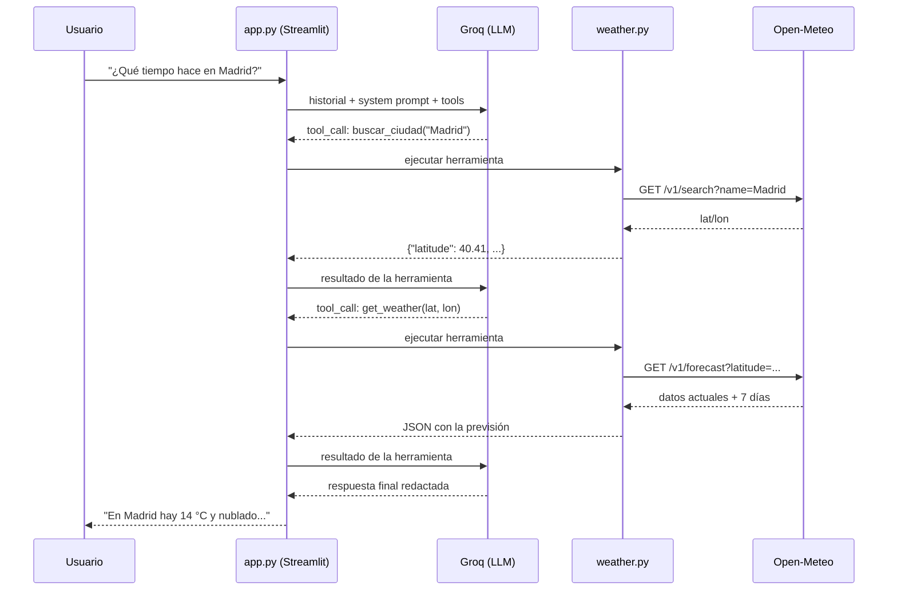

# 📖 Guía paso a paso: crear y conectar el MeteoAsistente

Guía pensada para **seguirla en directo** y reproducir el proyecto delante de tus compañeros. Tiempo estimado total: **20–30 minutos**.

---

## 1. Prerrequisitos (antes de empezar)

| Qué necesitar | Por qué | Comprobación |
|---|---|---|
| Python 3.9 o superior | Lenguaje del proyecto | `python --version` en una terminal |
| Una cuenta gratis en [console.groq.com](https://console.groq.com) | Para obtener la API key del LLM | Registrarte con email o GitHub |
| Un editor de código (VS Code, etc.) | Para ver y editar los archivos | — |
| Este proyecto descargado | El código base | Carpeta con `app.py`, `assistant.py`, `weather.py` |

> **Concepto**: una **API key** es como una contraseña que identifica tu aplicación ante el servicio. Nunca la compartas ni la subas a GitHub.

---

## 2. Paso 1 — Crear la API key de Groq (≈2 min)

1. Entra en <https://console.groq.com> y regístrate.
2. En el menú lateral, ve a **API Keys**.
3. Pulsa **Create API Key**, ponle un nombre (ej. `mi-chat-meteo`) y créala.
4. **Copia la clave ahora** (empieza por `gsk_...`). Solo se muestra una vez.

---

## 3. Paso 2 — Preparar el proyecto (≈3 min)

Abre una terminal **en la carpeta del proyecto** y ejecuta:

```bash
# 1. Crear entorno virtual (aisla las dependencias de tu equipo)
python -m venv venv

# 2. Activarlo
venv\Scripts\activate        # Windows
# source venv/bin/activate   # Mac/Linux

# 3. Instalar dependencias
pip install -r requirements.txt
```

Verás `(venv)` al principio de la línea de la terminal: ya está activo.

| Paquete | Para qué sirve |
|---|---|
| `streamlit` | La interfaz web del chat |
| `groq` | Cliente oficial para llamar a la API de Groq |
| `requests` | Peticiones HTTP a la API de Open-Meteo |

---

## 4. Paso 3 — Configurar la API key (≈1 min)

```bash
copy .streamlit\secrets.toml.example .streamlit\secrets.toml   # Windows
# cp .streamlit/secrets.toml.example .streamlit/secrets.toml    # Mac/Linux
```

Abre `.streamlit/secrets.toml` y pega tu clave donde pone `"gsk_..."`:

```toml
GROQ_API_KEY = "gsk_ tu_clave_real_aquí"
```

> Este archivo está en `.gitignore`: Git lo ignora para que la clave nunca se suba al repositorio.

---

## 5. Paso 4 — Entender los tres archivos (≈5 min)

El proyecto se separa en tres piezas, cada una con una responsabilidad:

| Archivo | Responsabilidad | Analogía |
|---|---|---|
| `weather.py` | Habla con **Open-Meteo**: busca ciudades y trae la previsión | El **meteorólogo** que consulta los mapas |
| `assistant.py` | Habla con **Groq** y gestiona el bucle de *function calling* | El **cerebro** que decide qué hacer |
| `app.py` | La **interfaz** del chat en el navegador | La **cara** que ve el usuario |

### 5.1 `weather.py` — las herramientas

Define **qué puede hacer** el asistente. Dos funciones:

```python
def buscar_ciudad(nombre):
    # nombre "Madrid"  ->  {"latitude": 40.41, "longitude": -3.70, ...}

def get_weather(latitude, longitude, lugar):
    # coordenadas  ->  {"ahora": {...}, "proximos_7_dias": [...]}
```

Junto a ellas está el **esquema `TOOLS`**: el JSON que le enviamos a Groq para que sepa que esas funciones existen, qué parámetros tienen y cuándo usarlas.

Los códigos numéricos del tiempo (por ejemplo `61` = lluvia ligera) se traducen al español con el diccionario `WMO_CODES`.

### 5.2 `assistant.py` — el bucle de function calling

El corazón del proyecto. Para cada pregunta:

```python
completacion = cliente.chat.completions.create(
    model=modelo,
    messages=historial,      # system prompt + chat completo
    tools=TOOLS,             # las herramientas de weather.py
)

if not mensaje.tool_calls:
    return mensaje.content   # respondió directamente (o rechazó la pregunta)
# si pidió herramientas: las ejecuta, devuelve el resultado y vuelve a preguntar
```

También está el **system prompt**, que es donde se impone la regla clave:

```text
3. Ante cualquier pregunta que NO sea de meteorología ... respondes
   EXACTAMENTE esta frase y nada más:
   "No tengo acceso a ese tipo de información."
```

### 5.3 `app.py` — la interfaz

- Muestra el historial con `st.chat_message`.
- Recibe la pregunta con `st.chat_input`.
- Llama a `responder()` de `assistant.py` y pinta la respuesta.
- En la barra lateral: modelo seleccionable, explicación breve y estado de la API key.

---

## 6. Paso 5 — Ejecutar la aplicación (≈1 min)

```bash
streamlit run app.py
```

Se abrirá sola una pestaña del navegador con el chat. Para parar el servidor: `Ctrl + C` en la terminal.

---

## 7. Paso 6 — Ponerlo a prueba (≈5 min)

Ejecuta esta tabla de casos delante de la clase:

| # | Pregunta | Respuesta esperada |
|---|---|---|
| 1 | ¿Qué tiempo hace en Madrid? | Temperatura actual, estado del cielo y previsión de 7 días **reales** |
| 2 | ¿Lloverá esta semana en Barcelona? | Probabilidad de lluvia real por día |
| 3 | ¿Cuál es la previsión para Ciudad de México? | Datos reales (funciona con cualquier ciudad del mundo) |
| 4 | ¿Quién ganó el partido de ayer? | *"No tengo acceso a ese tipo de información."* |
| 5 | Explícame la Revolución Francesa | *"No tengo acceso a ese tipo de información."* |
| 6 | ¿Qué es un front cálido? | Respuesta teórica sobre meteorología (no necesita datos en vivo) |
| 7 | ¿Tiempo en Wikilandia? | El asistente dirá que no encontró el lugar |

**Puntos a destacar para la clase:**
- Los casos 1-3 devuelven **datos actuales** que el LLM no conoce: los obtiene de Open-Meteo en el momento.
- El caso 4 demuestra el **filtro**: el LLM *podría* responder, pero el system prompt se lo impide.
- El caso 6 demuestra que también distingue entre *datos de una ciudad* y *conocimiento meteorológico general*.

---

## 8. Cómo funciona por dentro (guion para la exposición)

> "El usuario escribe en Streamlit, que envía el historial a la API de Groq. Groq, antes de contestar, comprueba si tiene herramientas disponibles. Si la pregunta es meteorológica, no redacta la respuesta: devuelve una *tool call*, es decir, el nombre de una función y sus parámetros. Nuestro código Python ejecuta esa función, que llama a Open-Meteo, y devuelve el JSON resultante como un mensaje más del chat. Con esos datos, Groq redacta ya sí la respuesta final en español. Si la pregunta no es de meteorología, no pide ninguna herramienta y el system prompt hace que conteste con la frase de rechazo. Es decir: **el LLM decide, pero es el código quien toca las APIs**."



**Vocabulario mínimo para la exposición:**

| Término | Significado en una frase |
|---|---|
| *LLM* | Modelo de lenguaje que genera texto a partir de patrones aprendidos |
| *Function calling / tool use* | El LLM decide llamar a una función que ejecuta tu código |
| *System prompt* | Instrucciones fijas que dan personalidad y límites al asistente |
| *API* | Interfaz web que permite pedir datos o servicios a otro programa |
| *Token* | Unidad de texto que el modelo procesa; Groq cobra por token |

---

## 9. Solución de problemas

| Problema | Causa probable | Solución |
|---|---|---|
| *"Falta la API key de Groq"* al abrir | No existe `secrets.toml` o está vacío | Repite el Paso 3 y comprueba que la clave empieza por `gsk_` |
| *"The API key provided is invalid"* | Clave copiada mal o revocada | Crea otra key en console.groq.com/keys y pégala de nuevo |
| *404 model_not_found* | El modelo seleccionado fue retirado de Groq | Elige un modelo activo en el selector lateral (GPT-OSS 120B/20B); Groq retira modelos antiguos de vez en cuando |
| `streamlit` no se reconoce | Entorno virtual desactivado | `venv\Scripts\activate` y vuelve a ejecutar |
| Puerto 8501 ya ocupado | Otro Streamlit en marcha | `Ctrl + C` en la terminal anterior o `streamlit run app.py --server.port 8502` |
| *"No encontré ningún lugar llamado..."* | Nombre de ciudad inexistente | Prueba con el nombre oficial o en inglés |
| Error de red al consultar el tiempo | Sin conexión a internet | Comprueba tu conexión; Open-Meteo no requiere configuración |
| El asistente responde algo raro a una pregunta fuera de tema | El LLM a veces se salta el prompt | Vuelve a preguntar; en `assistant.py` la regla está en la línea del system prompt 3 |

---

## Ideas para ampliar (opcional)

- Añadir más herramientas: calidad del aire (Open-Meteo *Air Quality*) o predicción de horas de sol.
- Mostrar en la interfaz qué herramientas llamó el LLM (para visualizar el *function calling*).
- Añadir *streaming* para que el texto aparezca palabra a palabra.
- Desplegar la app gratis en [Streamlit Community Cloud](https://streamlit.io/cloud) (subiendo la key como *secret* de la plataforma, nunca del repositorio).
