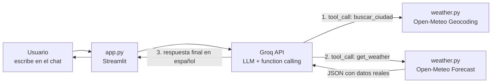

# ⛅ MeteoAsistente

Pequeño proyecto educativo: un **chat con un LLM de Groq** conectado a una **API meteorológica real (Open-Meteo)**, construido con **Streamlit**.

El asistente **solo responde preguntas de meteorología**. Ante cualquier otro tema responde:

> No tengo acceso a ese tipo de información.

---

## Stack

| Tecnología | Para qué |
|---|---|
| [Streamlit](https://streamlit.io) | Interfaz de chat en el navegador |
| [Groq](https://console.groq.com) | Inferencia del LLM (GPT-OSS 120B, etc.) |
| [Open-Meteo](https://open-meteo.com) | Datos reales de tiempo (gratis, sin API key) |

## Arquitectura



## Flujo paso a paso

1. El usuario escribe una pregunta en `app.py`.
2. La pregunta (junto al historial) se envía a la API de Groq con un **system prompt** que restringe el asistente a meteorología y con la definición de dos **herramientas** (*tools*).
3. El LLM decide:
   - **No es de meteorología** → responde sin tocar herramientas: *"No tengo acceso a ese tipo de información."*
   - **Es de meteorología con datos reales** → devuelve un *tool call*. Python ejecuta la herramienta (`buscar_ciudad` → `get_weather`), que consulta Open-Meteo y devuelve el JSON con los datos.
4. El JSON se devuelve al LLM, que redacta la respuesta final en español para el usuario.

A este patrón se le llama **function calling**: el LLM no "navega" a la API, sino que *decide qué función llamar* y el código de Python es quien hace la petición HTTP real.

## Estructura

```
.
├── app.py                      # Interfaz de chat (Streamlit)
├── assistant.py                # Cliente Groq, system prompt y bucle de function calling
├── weather.py                  # Herramientas: geocodificación + previsión (Open-Meteo)
├── requirements.txt            # Dependencias
├── .streamlit/
│   └── secrets.toml.example    # Plantilla para tu API key de Groq
├── GUIA.md                     # Guía paso a paso para reproducir el proyecto
└── README.md                   # Este archivo
```

## Arranque rápido

```bash
python -m venv venv
venv\Scripts\activate          # Windows (en Mac/Linux: source venv/bin/activate)
pip install -r requirements.txt
# Crea .streamlit/secrets.toml a partir del .example y pega tu API key de Groq
streamlit run app.py
```

Para la explicación completa paso a paso, sigue **[GUIA.md](GUIA.md)**.

## Licencia de datos

Open-Meteo es gratuito para uso **no comercial** ([términos](https://open-meteo.com/en/features)). El código de este proyecto es libre para uso educativo.
